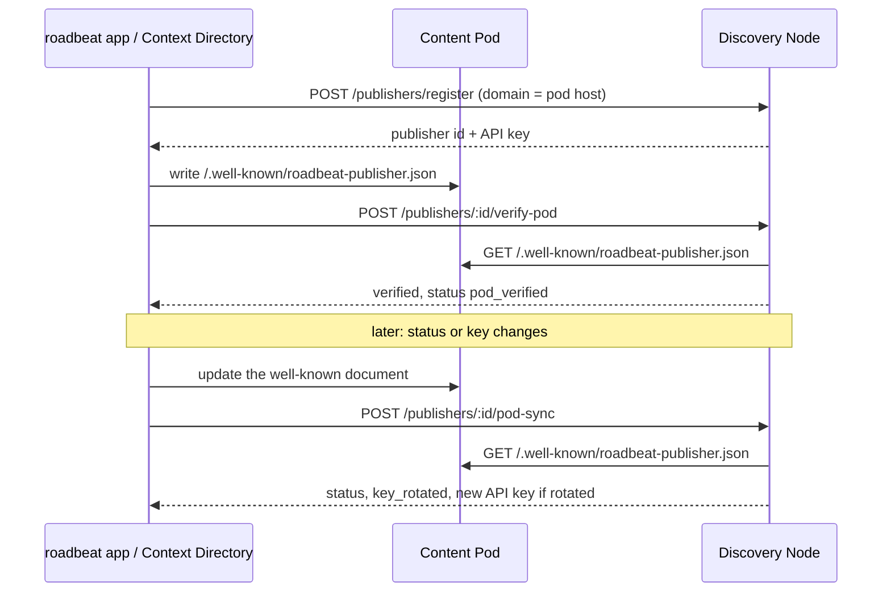

Not every publisher owns a domain. Individuals who publish from the roadbeat app host their content in a **Content Pod** (e.g. `jane.pods.roadbeat.net`) — they cannot add a DNS TXT record. For them the Discovery Node verifies the **pod host** instead: the pod serves a small JSON document that names the publisher and its public key.

The same document is the owner's voice towards every Discovery Node: it says whether the publisher is active, switched off, or deleted, and which key is current.



## The well-known document

The pod serves `https://<pod host>/.well-known/roadbeat-publisher.json`:

```json
{
  "version": 1,
  "podHost": "jane.pods.roadbeat.net",
  "publicKey": "-----BEGIN PUBLIC KEY-----\nMCowBQYDK2VwAyEA...\n-----END PUBLIC KEY-----",
  "status": "active",
  "publishers": [
    { "nodeUrl": "https://discover.roadbeat.net", "publisherId": "6f1c2a9e-4b1d-4d7a-9f3e-2c8b5a1d0e42" }
  ],
  "updatedAt": "2026-11-07T15:00:00.000Z"
}
```

The Discovery Node reads three fields:

| Field | Meaning |
|-------|---------|
| `publicKey` | The publisher's current Ed25519 public key (PEM). Compared independently of line wrapping. |
| `publishers[].publisherId` | The publisher ids registered for this pod. The node's own publisher id must be listed. |
| `status` | `active`, `suspended` (or `deactivated`), or `deleted` — applied by [pod sync](#pod-sync). |

<Callout kind="alert">
  A pod that is suspended must **keep serving** its well-known document — otherwise the nodes cannot learn that the publisher is switched off or deleted.
</Callout>

## Allowed pod hosts

The node fetches well-known documents **only from configured pod hosts** (SSRF protection):

| Variable | Default | Description |
|----------|---------|-------------|
| `POD_VERIFY_HOSTS` | `.pods.roadbeat.net` | Comma-separated host list, always fetched over **https**. An entry starting with `.` matches every subdomain (`jane.pods.roadbeat.net`, not `pods.roadbeat.net` itself). |
| `POD_VERIFY_INSECURE_HOSTS` | *(empty)* | Exact `host[:port]` entries fetched over **http** — for local development only. Leave empty in production. |

The publisher's `domain` is the pod host, optionally followed by up to two path segments for pods served under a path (e.g. `pods.example.org/jane`). The fetch follows no redirects, times out after 5 seconds, and accepts at most 64 KB.

## Verify a publisher via its pod

After the well-known document is in place, request the verification:

```bash
curl -X POST http://localhost:3300/api/v1/publishers/{id}/verify-pod
```

```json
{ "verified": true }
```

On failure the response explains why — for example:

```json
{ "verified": false, "reason": "public key does not match" }
```

| `reason` | Fix |
|----------|-----|
| `domain is not a known Content Pod host` | The publisher's `domain` is not covered by `POD_VERIFY_HOSTS` / `POD_VERIFY_INSECURE_HOSTS` |
| `well-known document: HTTP 404` | The pod does not serve the document (yet) |
| `public key does not match` | The document's `publicKey` differs from the key registered on the node |
| `publisher is not listed in the well-known document` | Add the node's publisher id to `publishers[]` |

A successful check upgrades an `unverified` publisher to **`pod_verified`**:

- Its teasers carry `publisher.verified: true`.
- Its [rate limits](/features/publishers#verification-levels) stay those of unverified publishers (100 teasers/day, 60 requests/min).
- It may set a [publisher picture](/features/publisher-self-service#publisher-picture) from its pod.

## Pod sync

`POST /api/v1/publishers/{id}/pod-sync` re-reads the well-known document and applies what the owner declared there. It needs **no API key** — the document on the owner's pod is the authority, and only configured pod hosts are read.

```bash
curl -X POST http://localhost:3300/api/v1/publishers/{id}/pod-sync
```

```json
{ "status": "deactivated", "key_rotated": false }
```

| Document `status` | Effect on the node |
|-------------------|--------------------|
| `active` (or anything else) | Publisher active — teasers visible |
| `suspended` / `deactivated` | Publisher [switched off](/features/publisher-self-service#switch-the-publisher-off-and-on) — no ingest, teasers hidden |
| `deleted` | The publisher **and all its teasers** are removed from the node (account purge) |

```json
{ "status": "deleted", "key_rotated": false, "teasers_deleted": 42 }
```

### Key rotation after losing the device

If the document declares a **new** `publicKey`, the node takes it over only with a fresh proof of possession of that key — the same proof as for [self-service key rotation](/features/publisher-self-service#rotate-the-signing-key):

```bash
curl -X POST http://localhost:3300/api/v1/publishers/{id}/pod-sync \
  -H "Content-Type: application/json" \
  -d '{
    "timestamp": "2026-11-09T10:15:00.000Z",
    "signature": "<base64 signature of roadbeat-key-rotation:<id>:<timestamp> with the new key>"
  }'
```

```json
{ "status": "active", "key_rotated": true, "api_key": "rb_pub_4f9c..." }
```

The node then issues a **new API key**, returned **once** in `api_key`; the old device's API key stops working immediately. This lets an owner who lost both the device and its API key regain control from a new device — without any admin.

Without a valid proof the key is not changed and the response explains why:

```json
{
  "status": "active",
  "key_rotated": false,
  "reason": "the pod declares a new public key; a fresh signature of that key is required to take it over"
}
```

## Errors

| Status | Message | Cause |
|--------|---------|-------|
| `400` | `publisher is not hosted on a known Content Pod` | `domain` not covered by the configured pod hosts (pod sync) |
| `400` | `well-known document: …` | Document unreachable, not JSON, larger than 64 KB, or a redirect |
| `400` | `publisher is not listed in the well-known document` | The node's publisher id is missing in `publishers[]` |
| `404` | `Publisher … not found` | Unknown publisher id |
