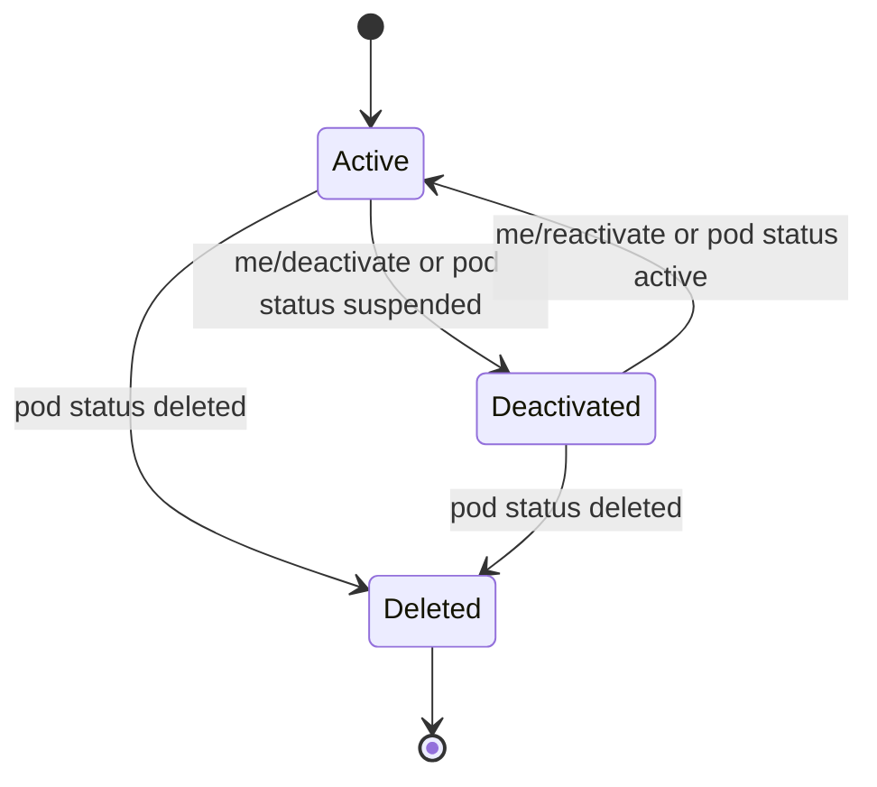

A registered publisher can manage its own record with nothing but its API key. No admin is involved: the `/api/v1/publishers/me…` endpoints act on the publisher the `X-Publisher-Key` belongs to.

| Method | Endpoint | Purpose |
|--------|----------|---------|
| `GET` | `/api/v1/publishers/me` | Check whom the API key belongs to |
| `PUT` | `/api/v1/publishers/me/description` | Set or remove the "About" text (per language) |
| `PUT` | `/api/v1/publishers/me/avatar` | Set or remove the publisher picture (Content Pod publishers) |
| `PUT` | `/api/v1/publishers/me/public-key` | Replace the Ed25519 signing key (with proof of possession) |
| `POST` | `/api/v1/publishers/me/deactivate` | Switch the publisher off |
| `POST` | `/api/v1/publishers/me/reactivate` | Switch the publisher back on |

<Callout kind="info">
  All responses except `GET /me` return the publisher record in its **owner view**: the public fields plus your contact name and e-mail. The API key hash is never returned. Other callers only ever see the [public fields](/features/publishers#public-publisher-record).
</Callout>

## Check the key's owner

Before a client writes anything with a stored key, it can check which publisher the key belongs to:

```bash
curl http://localhost:3300/api/v1/publishers/me \
  -H "X-Publisher-Key: rb_pub_a1b2c3..."
```

```json
{
  "id": "6f1c2a9e-4b1d-4d7a-9f3e-2c8b5a1d0e42",
  "name": "EnergyNews DE",
  "domain": "energynews.de"
}
```

## About text

The "About" text describes the publisher in consumer apps (publisher profile, "why am I seeing this?"). It is stored per two-letter language code:

```bash
curl -X PUT http://localhost:3300/api/v1/publishers/me/description \
  -H "X-Publisher-Key: rb_pub_a1b2c3..." \
  -H "Content-Type: application/json" \
  -d '{
    "description": {
      "en": "Independent energy news from Germany.",
      "de": "Unabhängige Energie-Nachrichten aus Deutschland."
    }
  }'
```

Rules:

- Keys must be two-letter lowercase language codes (`en`, `de`, `fr`, …) — at most 30 languages.
- Values are **plain text**, at most **2,000 characters** each. Control characters (except line breaks) are removed and the text is trimmed.
- Empty entries are dropped. Send `{ "description": null }` (or `{}`) to remove the text completely.

The text appears as `description` in the public publisher record (`GET /api/v1/publishers` and `GET /api/v1/publishers/:id`).

## Publisher picture

A publisher picture is **opt-in** by its owner and limited to publishers verified through their [Content Pod](/features/content-pod-publishers): the URL must point to a file **inside the publisher's own pod**.

```bash
curl -X PUT http://localhost:3300/api/v1/publishers/me/avatar \
  -H "X-Publisher-Key: rb_pub_a1b2c3..." \
  -H "Content-Type: application/json" \
  -d '{ "avatar_url": "https://jane.pods.roadbeat.net/assets/avatar.webp" }'
```

Send `{ "avatar_url": null }` to remove the picture. The URL is rejected with `400` when:

- the publisher is not `pod_verified`,
- the URL points to another host or outside the pod's path,
- the URL contains credentials, or is longer than 500 characters.

<Callout kind="tip">
  Why so strict? A picture URL on a third-party host would let that host see every reader who opens the publisher profile — effectively a tracking pixel. Files in the publisher's own pod keep the data flow between the reader and the publisher.
</Callout>

## Rotate the signing key

Teasers are signed with the publisher's Ed25519 key (see [Content signing](/api-reference/authentication#content-signing-ed25519)). To replace the public key, the request must **prove possession of the new key**: sign the message

```text
roadbeat-key-rotation:<publisherId>:<timestamp>
```

with the **new** private key. `timestamp` is an ISO 8601 date-time and must not be older than **5 minutes**.

<Steps>
  <Step title="Create the new key pair and the proof">
    ```javascript
    import { generateKeyPairSync, sign } from 'node:crypto';

    const publisherId = '6f1c2a9e-4b1d-4d7a-9f3e-2c8b5a1d0e42';
    const { publicKey, privateKey } = generateKeyPairSync('ed25519');

    const timestamp = new Date().toISOString();
    const message = `roadbeat-key-rotation:${publisherId}:${timestamp}`;
    const signature = sign(null, Buffer.from(message, 'utf-8'), privateKey).toString('base64');

    const body = {
      public_key: publicKey.export({ type: 'spki', format: 'pem' }),
      timestamp,
      signature,
    };
    ```
  </Step>
  <Step title="Send it with the API key">
    ```bash
    curl -X PUT http://localhost:3300/api/v1/publishers/me/public-key \
      -H "X-Publisher-Key: rb_pub_a1b2c3..." \
      -H "Content-Type: application/json" \
      -d @rotation.json
    ```
  </Step>
  <Step title="Sign new teasers with the new key">
    The node stores the key in normalized PEM form. From now on, teaser signatures are verified against the new key.
  </Step>
</Steps>

The API key itself does not change. If the **API key** is lost as well (e.g. a lost phone), a Content Pod publisher can rotate both via [pod sync](/features/content-pod-publishers#pod-sync); other publishers ask the node admin to [rotate the API key](/features/publishers#key-rotation-admin).

## Switch the publisher off and on

```bash
# Switch off
curl -X POST http://localhost:3300/api/v1/publishers/me/deactivate \
  -H "X-Publisher-Key: rb_pub_a1b2c3..."

# Switch on again
curl -X POST http://localhost:3300/api/v1/publishers/me/reactivate \
  -H "X-Publisher-Key: rb_pub_a1b2c3..."
```

While a publisher is deactivated by its owner (`ownerDeactivated: true`):

- **No ingest** — every publisher-key endpoint answers `403 Publisher is deactivated by its owner`, except `me/reactivate` and `me/public-key`.
- **Offline** — its teasers disappear from content search, goal search, suggestions, teaser lookups, and "more like this".
- **Nothing is deleted** — the teasers stay in the index, so reactivation brings them back instantly.



A typical use is a scheduled account deletion: the publisher goes offline at once, can come back if the deletion is cancelled, and is removed with all its teasers when the account is purged (see [Content Pod publishers](/features/content-pod-publishers#pod-sync)).

<Callout kind="info">
  The node caches the set of switched-off publishers for up to 15 seconds and clears its search and suggestion caches on every change, so a switch takes effect within seconds on all search endpoints.
</Callout>

## Errors

| Status | Message | Cause |
|--------|---------|-------|
| `400` | `public_key must be a PEM-encoded Ed25519 public key` | The new key is not an Ed25519 SPKI PEM key |
| `400` | `signature must prove possession of the new key (fresh timestamp)` | Wrong signature, wrong message, or timestamp older than 5 minutes |
| `400` | `description: "xx1" is not a two-letter language` | Invalid language key in the About text |
| `400` | `avatar_url must point into your own verified Content Pod` | See [Publisher picture](#publisher-picture) |
| `401` | `Invalid API key` | Unknown key, or the publisher is suspended by an admin |
| `403` | `Publisher is deactivated by its owner` | Reactivate the publisher first |
