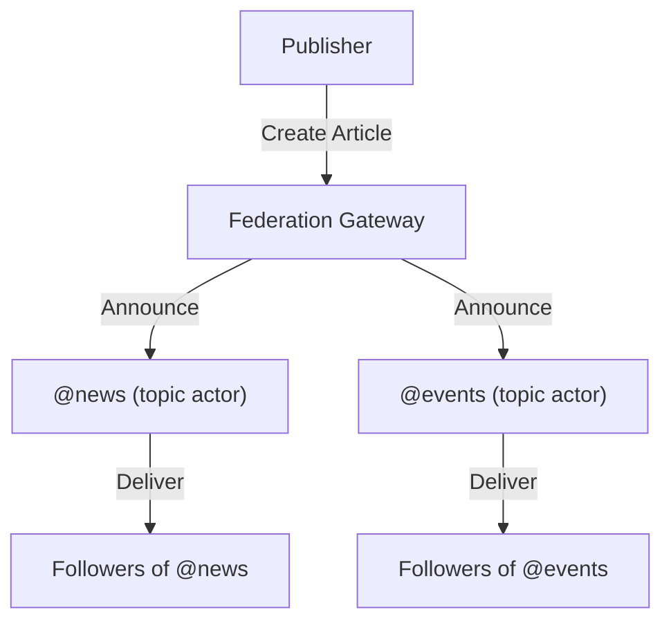

## Overview

Discovery Nodes participate in the Fediverse as **topic relay actors**. Each content type or category gets its own ActivityPub actor that announces (boosts) relevant content to its followers. This bridges roadbeat's structured content discovery with the open Fediverse.

<Callout kind="info">
  Topic relay actors are `Service`-type actors. Remote users follow them to receive curated content by topic — without needing to know individual publishers.
</Callout>



## Topic Actor Mapping

Each content type maps to a dedicated AP actor:

| Content Type | Handle | Description |
|-------------|--------|-------------|
| `news` | `@news@federation.roadbeat.net` | News articles |
| `events` | `@events@federation.roadbeat.net` | Event announcements |
| `jobs` | `@jobs@federation.roadbeat.net` | Job listings |
| `learning_material` | `@learning@federation.roadbeat.net` | Educational content |
| `research` | `@research@federation.roadbeat.net` | Research publications |
| `products` | `@products@federation.roadbeat.net` | Product listings |
| `places` | `@places@federation.roadbeat.net` | Location guides |
| `case_study` | `@casestudies@federation.roadbeat.net` | Case studies |

## How It Works

<Steps>
  <Step title="Publisher creates content" icon="edit">
    A publisher creates content of a specific type (e.g. a news article) in Studio.
  </Step>
  <Step title="Gateway federates via org actor" icon="send">
    The Federation Gateway publishes a `Create(Article)` activity from the publisher's organization actor.
  </Step>
  <Step title="Topic actor announces" icon="share-2">
    The gateway simultaneously publishes an `Announce` activity from the topic actor (e.g. `@news`), boosting the content to all topic followers.
  </Step>
  <Step title="Remote users see content" icon="eye">
    Users following `@news@federation.roadbeat.net` on Mastodon see the article in their home timeline as a boost.
  </Step>
</Steps>

## What Gets Relayed

<Columns cols={2}>
  <Card title="Included" icon="check-circle" href="#included">
    Published content from opted-in publishers.
  </Card>
  <Card title="Excluded" icon="circle-x" href="#excluded">
    Drafts, blocked publishers, rate-exceeded content.
  </Card>
</Columns>

### Included

- All content published through the federation gateway matching the topic's content type
- Content from publishers who have **not** disabled topic relay

### Excluded

- Draft or unpublished content
- Content marked `federationExclude: true`
- Content from suspended or blocked publishers
- Duplicate announces (deduplicated by object IRI)
- Content exceeding rate limits (max 20 announces per topic per hour)

## Rate Limiting

To avoid flooding followers' timelines:

| Limit | Value |
|-------|-------|
| Max announces per topic per hour | 20 |
| Max announces per topic per day | 200 |
| Burst allowance | 5 within 1 minute |

<Callout kind="tip">
  When rate limits are hit, content is queued and delivered in the next available window. No content is lost — just delayed.
</Callout>

## Subscriber Statistics

The Discovery Node tracks topic relay performance:

| Metric | Description |
|--------|-------------|
| Followers per topic | Total remote followers of each topic actor |
| Announces per day/week | Activity volume per topic |
| Engagement (likes/boosts) | How often relayed content is liked or re-boosted |
| Follower growth | Daily/weekly subscriber trends |
| Top content | Most-engaged announcements per period |

## Configuration

```env
TOPIC_RELAY_ENABLED=true
TOPIC_RELAY_MAX_PER_HOUR=20
TOPIC_RELAY_AUTO_CREATE_ACTORS=true
TOPIC_RELAY_DISCOVERY_NODE_URL=https://discover.roadbeat.net
```

## Moderation

- Topic actors respect the instance-level blocklist (blocked hosts don't receive announces)
- Individual publishers can be excluded from topic relay via admin API
- Remote instances can mute/block topic actors like any other account
- Topic actors never boost content that triggered content filter rules
